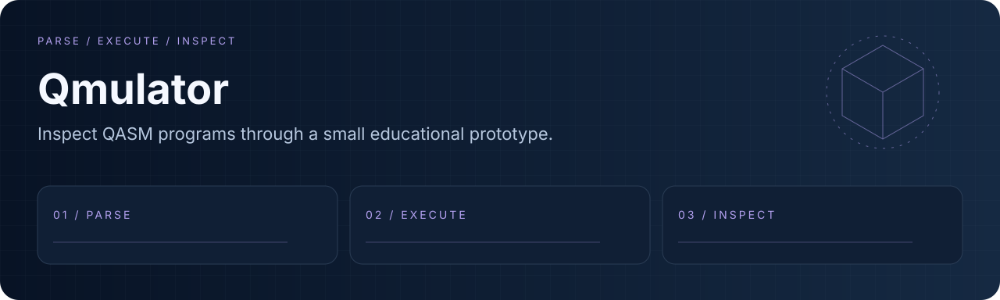
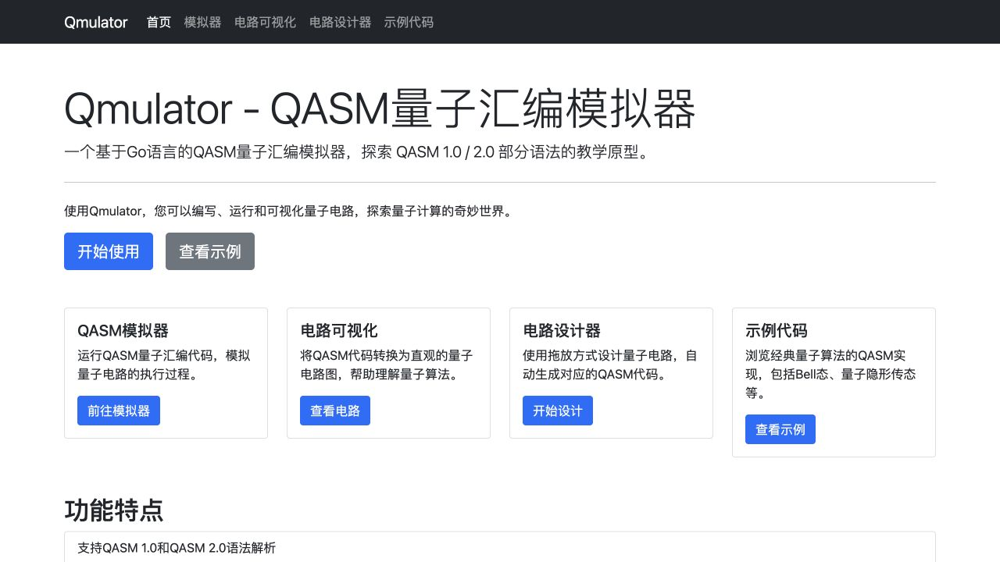

<div align="center">
  
  <h1>Qmulator</h1>
  <p><strong>Inspect QASM programs through a small educational prototype.</strong></p>
  <p><a href="LICENSE"></a> <a href="docs/readme/validation.md"></a></p>
  <p><a href="#overview">Overview</a> · <a href="#quick-start">Quick start</a> · <a href="#workflow">Workflow</a> · <a href="#validation">Validation</a> · <a href="#documentation">Docs</a></p>
  <p><a href="README.en.md">English</a> · <a href="README.md">简体中文</a></p>
</div>

---

<a id="overview"></a>
## Overview

A Go QASM parser, CLI and web interface for educational exploration. The current simulator represents separate qubits and is not a general joint-state quantum engine.

| Capability | What it provides |
| :--- | :--- |
| **QASM exploration** | Parser and example programs for inspecting supported syntax. |
| **CLI / API** | Run files or inspect the local HTTP interface. |
| **Circuit view** | Browser-based circuit examples and visualization. |

### Local interface



<a id="quick-start"></a>
## Quick start

```bash
git clone https://github.com/eust-w/qmulator.git
cd qmulator
go mod download
go build -o qmulator .
./qmulator run -f examples/bell_state.qasm
./qmulator serve --port 8080 --ui
# Open http://127.0.0.1:8080/ui
```

<a id="workflow"></a>
## Workflow

```text
PARSE → EXECUTE → INSPECT
```

```bash
go test ./...
go build .
```

<a id="validation"></a>
## Validation

```bash
go test ./...
go build .
go run . run -f examples/bell_state.qasm
```

Recorded environment and executed checks: [validation notes](docs/readme/validation.md).

| Area | Current boundary |
| :--- | :--- |
| State model | Independent Alpha/Beta qubits cannot faithfully represent general entangled joint states. |
| Examples | Bell execution checks parsing and plumbing; it is not proof of correct entanglement simulation. |
| Compatibility | Supported parser constructs do not establish complete QASM standard compliance. |

<a id="documentation"></a>
## Docs

- [Parser / 解析器](pkg/parser/)
- [Simulator / 模拟器](pkg/simulator/simulator.go)
- [Examples / 示例](examples/)

## License and provenance

Original code and newly created demo assets are licensed under [MIT](LICENSE). Dependencies, models, datasets and external resources retain their terms; see [THIRD_PARTY_NOTICES.md](THIRD_PARTY_NOTICES.md).
